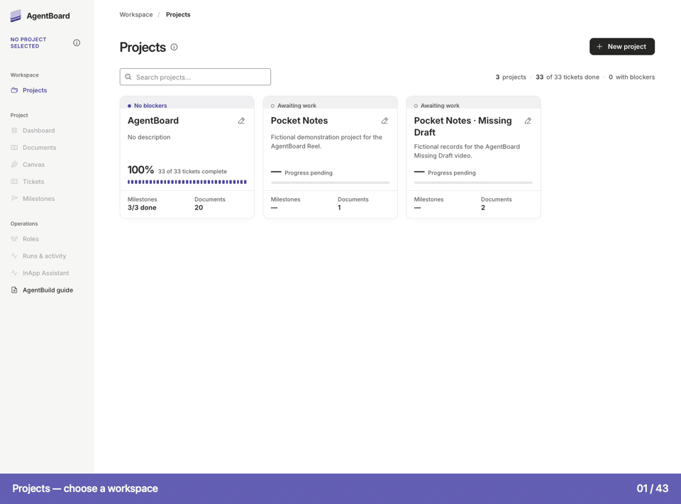
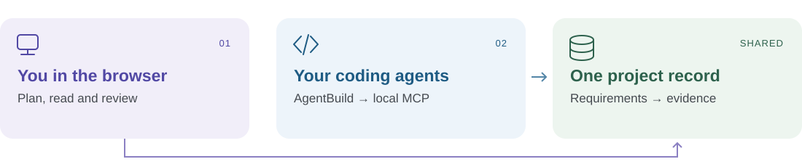

<div align="center">

# AgentBoard

**One project. Shared context. Work you can verify.**

[繁體中文](README.md) ｜ **English**

[](LICENSE)


[🚀 Start](#install-the-service) · [🧩 Skill](#install-the-skill) · [🗂️ Workflows](#first-project) · [🛠️ Develop](#development-and-verification)

</div>

**AgentBoard** stores requirements, designs, tickets and verification evidence. **AgentBuild** connects Codex or Claude Code to those records.

No model key is needed for the board or external agent connection. New installations start empty.

<p align="center">
  
</p>

*44-second interface tour · 43 views · [Open full size](assets/agentboard-walkthrough.gif). Includes fictional demo projects; not an end-to-end test report.*

---

<a id="why-agentboard"></a>

## 🎯 Why AgentBoard?

| Problem | Solution |
| --- | --- |
| Decisions get lost in chat. | Keep linked requirements and designs. |
| Agents follow different instructions. | Share tickets, context and acceptance criteria. |
| “Done” has no proof. | Save output evidence and change history. |

<picture>
  <source media="(max-width: 600px)" srcset="assets/agentboard-system-mobile.svg">
  
</picture>

<a id="install-the-service"></a>

## 🚀 1. Start the service

Install Git and Docker with Compose v2. Start Docker. Use a POSIX shell with OpenSSL; the first build needs internet access. Native Windows setup is unverified.

```sh
git clone https://github.com/CJsGit-tech/AgentBoard.git
cd AgentBoard
./scripts/setup.sh
```

Open **[localhost:8080](http://127.0.0.1:8080)**. Setup creates the database password at `.local/db_password` and preserves existing data.

Check service health:

```sh
docker compose ps
```

Expect `db`, `api` and `web` to be healthy. An empty Projects screen is normal.

<a id="install-the-skill"></a>

## 🧩 2. Install AgentBuild

Install Python 3.12+ and your agent host. **Choose one block** and run it from the AgentBoard checkout.

### Codex

```sh
python3 scripts/install-skill.py install \
  --host codex --scope project
codex mcp add agentboard-mvp -- \
  "$PWD/scripts/agentboard-mcp" Codex
```

### Claude Code

```sh
python3 scripts/install-skill.py install \
  --host claude --scope project
claude mcp add --scope local \
  --transport stdio agentboard-mvp -- \
  "$PWD/scripts/agentboard-mcp" Claude
```

Open a fresh host session if needed. Send this message:

```text
Use the agentboard-mvp MCP server to list projects.
```

An empty list means the connection works. The host needs local Docker access.

Project skill paths: `.agents/skills/agentbuild` for Codex; `.claude/skills/agentbuild` for Claude.

For personal installs, another repository or connection repairs, use the [connection guide](skills/agentbuild/references/connection.md). Skill installation and MCP registration are separate steps. See the [skill install guide](skills/README.md).

<a id="first-project"></a>

## 🗂️ 3. Create your project

Send this in **Codex**:

```text
$agentbuild Setup My Project
```

Or in **Claude Code**:

```text
/agentbuild Setup My Project
```

Then name the workflow you need:

| Workflow | Result |
| --- | --- |
| Setup | Project, default roles and document check. |
| Create Documents | Requirements and design drafts for review. |
| Create Visuals | Local Canvas; publish when requested. |
| Create Tickets | Planned milestone tickets with acceptance criteria. |

Approve document/design drafts before saving. Confirm changes to agreed scope. See [workflow examples](skills/agentbuild/references/commands.md).

<a id="optional-inapp-assistant"></a>

## 🧪 Optional InApp Assistant

> [!WARNING]
> **Experimental and not fully tested end to end.** Use a disposable project or backed-up source folder. Review changes before relying on them.

1. Open a project → **InApp Assistant → Settings**.
2. Enter your key, select a model and test the connection. **Provider charges may apply.**
3. Session keys clear when the API restarts. Environment-key configuration is shown in [.env.example](.env.example).

To enable file access, preview your folder selection, then apply it:

```sh
python3 scripts/setup-execution.py \
  --folder "/absolute/path/to/source" --dry-run
python3 scripts/setup-execution.py \
  --folder "/absolute/path/to/source" --apply
```

Commands can access the **entire selected folder**. Choose a dedicated source folder. Editing requires a reviewed ticket, Git and execution status **Ready**. The executor has no network, model key, database password or Docker socket.

<a id="updates-shutdown-and-data"></a>

## 🔄 Maintain your installation

**Start or rebuild:**

```sh
./scripts/setup.sh
```

**Stop:**

```sh
docker compose stop
```

With file execution configured, stop using both Compose files:

```sh
docker compose -f compose.yaml -f .local/execution.compose.yaml stop
```

**Update or remove the skill:** reuse its original host, scope and project options. Replace `codex` with `claude` when applicable.

```sh
python3 scripts/install-skill.py update --host codex --scope project
```

To uninstall instead:

```sh
python3 scripts/install-skill.py uninstall --host codex --scope project
```

Updates back up managed copies. Modified copies are preserved. Uninstall does not remove the service or MCP registration.

> [!IMPORTANT]
> Keep the `agentboard_mvp_workspace_v1` database volume and matching `.local/db_password` together. **Do not run `docker compose down --volumes` on a working installation:** it deletes workspace data. Verify backups before moving important data.

<a id="development-and-verification"></a>

## 🛠️ Development and verification

Browser clients read the directory at `GET /api/workspace?view=projects` and a project at `GET /api/workspace?project=<id>`. An older tab polling `GET /api/workspace` receives HTTP 410 with a reload instruction. A local integration that needs every record and review snapshot can request `GET /api/workspace?view=export` with the `X-AgentBoard-UI: 1` header. This full JSON export supports ETag revalidation.

Use Python 3.12+ and Node.js 22:

```sh
python3 -m pip install -r scripts/requirements-checks.txt
python3 scripts/check-skills.py
python3 -m unittest discover -s scripts/tests -v
npm ci --prefix frontend
npm run build --prefix frontend
npm test --prefix frontend
```

With the service running, test the backend:

```sh
docker compose exec -T api python -m unittest discover -s tests -v
```

Tests use temporary databases/directories. Clean up test resources; preserve user data. Workflow contract tests do not prove live-model behavior.

```text
backend/app/         API, MCP and application logic
backend/migrations/  Database migrations
frontend/src/        React application
frontend/public/     Icons, fonts and license notices
skills/agentbuild/   Shared skill instructions and helpers
skills/agentbuild-claude/  Claude Code entry and host guide
scripts/             Setup, installation and checks
assets/              README illustrations and GIF
README.md            Traditional Chinese guide
README.en.md         English guide
compose.yaml         Local service configuration
```

Author records, design snapshots and local-only folders are not bundled. Keep credentials, caches and generated files out of commits. GitHub automation is excluded; run checks manually.

<a id="software-bill-of-materials"></a>

## 📦 Software bill of materials

**MIT covers our original code.** Dependencies keep their own licenses. This lists direct components and tooling, not every package inside dependencies or images. Container tags can change.

| Layer | Component | Version / declared image | Purpose | License |
| --- | --- | --- | --- | --- |
| UI | React / React DOM | 18.3.1 | Browser interface | MIT |
| UI | Mantine Core / Hooks | 7.17.8 | Components and interactions | MIT |
| UI | Interest invokers polyfill | 1.0.14 resolved | Hover/focus help compatibility | BSD-3-Clause |
| UI | Popover polyfill | 0.7.3 resolved | Popover compatibility | BSD-3-Clause |
| Build | Vite | 6.4.6 resolved | Frontend bundling | MIT |
| Build | TypeScript | 5.8.3 resolved | Type checking | Apache-2.0 |
| API | FastAPI | 0.165.0 | HTTP API | MIT |
| MCP | FastMCP | 4.2.2 | Agent tool interface | Apache-2.0 |
| API | Uvicorn | 0.54.0 | ASGI server | BSD-3-Clause |
| Database adapter | Psycopg | 3.2.6 | PostgreSQL access | LGPL-3.0 |
| Assistant | OpenAI Agents SDK | 0.25.0 | Optional model-backed agent runtime | MIT |
| Database | PostgreSQL | `postgres:17` | Persistent project records | PostgreSQL License |
| Runtime | Python | `python:3.12-slim` | API runtime | PSF; image includes separately licensed OS packages |
| Build / executor | Node.js | `node:22-alpine` / `node:22-bookworm` | Frontend build / optional execution tools | MIT; bundled components have additional terms |
| Web | Nginx | `nginx:stable-alpine` | Static UI and API proxy | BSD-2-Clause; image includes OS packages |
| Check tooling | PyYAML | 6.0.3 | Skill metadata checks | MIT |
| Assets | Inter / Phosphor icons | Bundled files | Typography and icons | SIL OFL-1.1 / MIT |

Versions: [npm lockfile](frontend/package-lock.json) · [Python dependencies](backend/requirements.txt). Notices: [MIT](LICENSE) · [Inter](frontend/public/fonts/OFL-Inter.txt) · [Phosphor](frontend/public/LICENSE-phosphor).

<a id="troubleshooting"></a>

## 🩺 Troubleshooting

| Problem | Next step |
| --- | --- |
| Docker unavailable | Start Docker, then rerun setup. |
| Port 8080 occupied | Stop the conflicting process you own. |
| Agent tools missing | Check MCP registration and local Docker access; restart the host session. |
| Skill missing | Check host, installation scope and duplicate legacy copies. |
| Empty project list | Run Setup with your project name. |
| Assistant Not configured | Check model settings and file access separately. |
| Save outcome uncertain | Read saved state or use Retry sync before resubmitting. |

Inspect service errors:

```sh
docker compose logs --tail=50 api db
```

[Report a problem](https://github.com/CJsGit-tech/AgentBoard/issues) with reproduction steps and sanitized evidence. Never share keys, private conversations or database exports.

**Deployment:** one trusted local machine. Public hosting, multi-user authentication and cloud MCP are outside this setup. Processes with Docker access are trusted. AgentBoard records reported work; it does not supervise unrelated agent processes.
