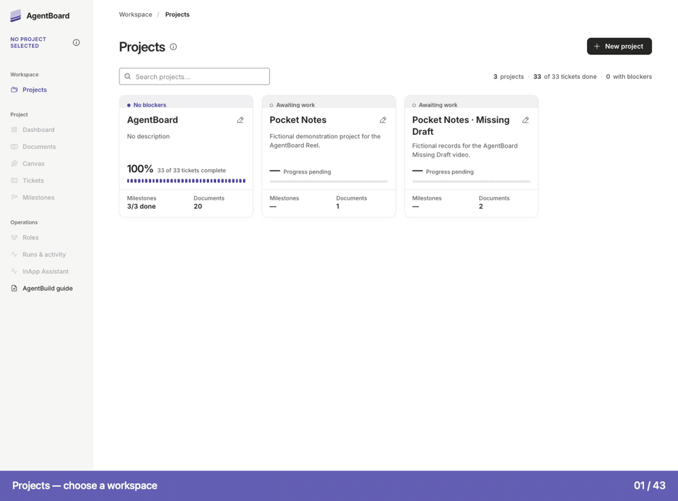
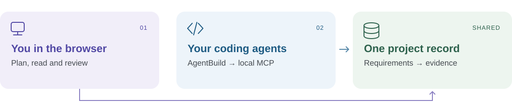

<div align="center">

# AgentBoard

**一個專案, 共用脈絡, 每一步都有依據。**

**繁體中文** ｜ [English](README.en.md)

[](LICENSE)


[🚀 啟動](#install-the-service) · [🧩 技能](#install-the-skill) · [🗂️ 專案](#first-project) · [📊 報表](#track-progress) · [🛠️ 開發](#development-and-verification) · [📝 更新紀錄](CHANGELOG.md)

</div>

**AgentBoard** 集中管理需求、設計、任務與驗證證據。**AgentBuild** 讓 Codex 或 Claude Code 讀取這些紀錄, 接續專案工作。

看板與外部代理連線不需要模型 API 金鑰。全新安裝會從空白工作區開始。

<p align="center">
  
</p>

*44 秒介面導覽 · 43 個畫面 · [查看原尺寸](assets/agentboard-walkthrough.gif)。含虛構示範專案, 非端對端測試報告。錄製於 V5 介面更新之前, 變更內容見[更新紀錄](CHANGELOG.md)。*

---

<a id="why-agentboard"></a>

## 🎯 解決什麼問題?

| 常見困擾 | AgentBoard 的做法 |
| --- | --- |
| 決策散落在聊天紀錄。 | 串起需求與設計文件。 |
| 不同代理掌握的資訊不一致。 | 共用任務、專案脈絡與驗收條件。 |
| 任務標記完成, 卻沒有證據。 | 保留驗證結果與修改歷程。 |

<picture>
  <source media="(max-width: 600px)" srcset="assets/agentboard-system-mobile.svg">
  
</picture>

<a id="track-progress"></a>

## 📊 掌握進度

| 位置 | 可以看到什麼 |
| --- | --- |
| **Dashboard** | 依專案目標顯示計分卡: 完成率、證據覆蓋率、執行成功率與「到最後更新的時間」中位數。頁首摘要會點出未達標的項目。圖表包含範圍與交付進度、每日證據覆蓋率、各里程碑與各角色的工作分布, 以及里程碑計分表。 |
| **Portfolio report** | 唯讀檢視所有專案: 完成率、執行成功率、每日累計完成、未完成工作的分布與各代理的執行次數。**Export report** 可下載 CSV。 |
| **Tickets** | 可篩選看板的狀態列、自動收合的空白欄位, 以及列出每項驗收條件與證據的側邊面板。 |
| **Milestones · Runs · Roles** | 里程碑時間軸與完成時間分布、代理執行時間軸, 以及各角色的工作量排名。 |

目標預設為完成率 100%、證據覆蓋率 90%、執行成功率 95%、中位數 4 小時以內, 可在**專案設定 → Dashboard targets** 調整。每張圖表都提供 **Table** 檢視。按 **⌘K** (Ctrl+K) 可快速跳到任一專案、文件或任務。

<a id="install-the-service"></a>

## 🚀 1. 啟動服務

準備 Git、Docker 與 Compose v2, 並先啟動 Docker。安裝腳本需要 POSIX shell 與 OpenSSL; 首次建置需要網路。原生 Windows 環境尚未驗證。

```sh
git clone https://github.com/CJsGit-tech/AgentBoard.git
cd AgentBoard
./scripts/setup.sh
```

開啟 **[localhost:8080](http://127.0.0.1:8080)**。安裝會在 `.local/db_password` 建立資料庫密碼, 並保留既有資料。

檢查服務狀態:

```sh
docker compose ps
```

`db`、`api`、`web` 應顯示為 healthy。專案清單空白是正常的。

<a id="install-the-skill"></a>

## 🧩 2. 安裝 AgentBuild

準備 Python 3.12+ 與你的代理工具。**選擇一組指令**, 在 AgentBoard 資料夾內執行。

### Codex

```sh
python3 scripts/install-skill.py install \
  --host codex --scope project
codex mcp add agentboard-mvp -- \
  "$PWD/scripts/agentboard-mcp" Codex
```

### Claude Code

```sh
python3 scripts/install-skill.py install \
  --host claude --scope project
claude mcp add --scope local \
  --transport stdio agentboard-mvp -- \
  "$PWD/scripts/agentboard-mcp" Claude
```

必要時開啟新的代理對話, 傳送:

```text
Use the agentboard-mvp MCP server to list projects.
```

收到空清單也代表連線成功。代理工具需要能存取本機 Docker。

技能安裝位置: Codex 使用 `.agents/skills/agentbuild`; Claude 使用 `.claude/skills/agentbuild`。

個人安裝、其他程式庫或連線修復, 請看[連線指南](skills/agentbuild/references/connection.md)。安裝技能與註冊 MCP 是兩個步驟。詳見[技能安裝指南](skills/README.md) (英文)。

<a id="first-project"></a>

## 🗂️ 3. 建立專案

在 **Codex** 傳送:

```text
$agentbuild Setup My Project
```

或在 **Claude Code** 傳送:

```text
/agentbuild Setup My Project
```

接著指定需要的工作流程:

| 工作流程 | 產出 |
| --- | --- |
| Setup | 專案、預設角色與文件檢查。 |
| Create Documents | 供你審閱的需求與設計草稿。 |
| Create Visuals | 本機 Canvas, 依要求發布。 |
| Create Tickets | 含驗收條件的里程碑任務。 |

文件與設計草稿經你確認後再儲存; 變更已同意的範圍也需確認。更多用法見[工作流程範例](skills/agentbuild/references/commands.md)。

<a id="optional-inapp-assistant"></a>

## 🧪 選用: InApp Assistant

> [!WARNING]
> **實驗功能, 尚未完成完整端對端測試。** 請使用可拋棄的測試專案或已備份的原始碼資料夾, 並檢查每次修改。

1. 開啟專案 → **InApp Assistant → Settings**。
2. 輸入金鑰、選擇模型並測試連線。**模型供應商可能收費。**
3. API 重啟後需重新輸入對話期間設定的金鑰。環境變數設定見 [.env.example](.env.example)。

啟用檔案存取前, 先預覽選取的資料夾, 再套用:

```sh
python3 scripts/setup-execution.py \
  --folder "/absolute/path/to/source" --dry-run
python3 scripts/setup-execution.py \
  --folder "/absolute/path/to/source" --apply
```

指令可存取**整個選定資料夾**, 請使用專用的原始碼資料夾。編輯需要已審閱的任務、Git 與 **Ready** 執行狀態。執行環境無網路、模型金鑰、資料庫密碼或 Docker socket。

<a id="updates-shutdown-and-data"></a>

## 🔄 日常維護

**啟動或重新建置:**

```sh
./scripts/setup.sh
```

**停止服務:**

```sh
docker compose stop
```

已啟用檔案執行功能時, 使用兩份 Compose 設定停止服務:

```sh
docker compose -f compose.yaml -f .local/execution.compose.yaml stop
```

**更新或移除技能:** 沿用原本的 host、scope 與 project 選項。Claude 使用者請將 `codex` 換成 `claude`。

```sh
python3 scripts/install-skill.py update --host codex --scope project
```

若要解除安裝:

```sh
python3 scripts/install-skill.py uninstall --host codex --scope project
```

更新會備份受管理的技能副本, 保留你修改過的副本。解除安裝不會移除服務或 MCP 註冊。

> [!IMPORTANT]
> 請一併保留 `agentboard_mvp_workspace_v1` 資料庫磁碟區與對應的 `.local/db_password`。**不要對使用中的安裝執行 `docker compose down --volumes`: 這會刪除工作區資料。** 搬移重要資料前, 請確認備份可還原。

<a id="development-and-verification"></a>

## 🛠️ 開發與驗證

瀏覽器透過 `GET /api/workspace?view=projects` 讀取專案清單, 透過 `GET /api/workspace?project=<id>` 讀取單一專案. 舊版分頁查詢 `GET /api/workspace` 時會收到 HTTP 410 與重新載入提示. 需要所有紀錄與審查快照的本機整合可使用 `GET /api/workspace?view=export`, 並傳入 `X-AgentBoard-UI: 1` 標頭. 完整 JSON 匯出支援 ETag 重新驗證. Dashboard 與 Portfolio 的數據來自唯讀的 `GET /api/projects/<id>/metrics` 與 `GET /api/portfolio`, 兩者皆接受 `start`、`end` (日期) 與 `tz_offset` (分鐘) 參數.

使用 Python 3.12+ 與 Node.js 22:

```sh
python3 -m pip install -r scripts/requirements-checks.txt
python3 scripts/check-skills.py
python3 -m unittest discover -s scripts/tests -v
npm ci --prefix frontend
npm run build --prefix frontend
npm test --prefix frontend
```

服務啟動後, 執行後端測試:

```sh
docker compose exec -T api python -m unittest discover -s tests -v
```

測試使用暫存資料庫與資料夾。測試後清理資源, 保留使用者資料。工作流程合約測試不代表真實模型行為已通過驗證。

```text
backend/app/         API、MCP 與應用邏輯
backend/migrations/  資料庫遷移
frontend/src/        React 應用程式
frontend/public/     圖示、字型與授權聲明
skills/agentbuild/   共用技能指引與輔助工具
skills/agentbuild-claude/  Claude Code 入口與使用指引
scripts/             安裝、設定與檢查
assets/              README 圖解與 GIF
README.md            繁體中文指南
README.en.md         英文指南
CHANGELOG.md         依日期記錄的重要變更
compose.yaml         本機服務設定
```

作者的專案紀錄、設計快照與本機專用資料夾不隨程式碼提供。金鑰、快取與產生的檔案不要提交。此版本不含 GitHub 自動化, 請手動執行檢查。

<a id="software-bill-of-materials"></a>

## 📦 軟體物料清單

**原創程式碼採 MIT 授權。** 相依元件保留各自授權。下表列出直接元件與工具, 不涵蓋所有間接套件或容器內容; 容器標籤可能指向新版本。

| 層級 | 元件 | 版本 / 映像 | 用途 | 授權 |
| --- | --- | --- | --- | --- |
| UI | React / React DOM | 18.3.1 | 瀏覽器介面 | MIT |
| UI | Mantine Core / Hooks | 7.17.8 | 元件與互動 | MIT |
| UI | Interest invokers polyfill | 1.0.14 resolved | 懸停與焦點提示相容性 | BSD-3-Clause |
| UI | Popover polyfill | 0.7.3 resolved | Popover 相容性 | BSD-3-Clause |
| Build | Vite | 6.4.6 resolved | 前端打包 | MIT |
| Build | TypeScript | 5.8.3 resolved | 型別檢查 | Apache-2.0 |
| API | FastAPI | 0.165.0 | HTTP API | MIT |
| MCP | FastMCP | 4.2.2 | 代理工具介面 | Apache-2.0 |
| API | Uvicorn | 0.54.0 | ASGI 伺服器 | BSD-3-Clause |
| Database adapter | Psycopg | 3.2.6 | PostgreSQL 存取 | LGPL-3.0 |
| Assistant | OpenAI Agents SDK | 0.25.0 | 選用的模型助理執行環境 | MIT |
| Database | PostgreSQL | `postgres:17` | 專案資料儲存 | PostgreSQL License |
| Runtime | Python | `python:3.12-slim` | API 執行環境 | PSF; 映像內作業系統套件另有授權 |
| Build / executor | Node.js | `node:22-alpine` / `node:22-bookworm` | 前端建置 / 選用的執行工具 | MIT; 隨附元件另有條款 |
| Web | Nginx | `nginx:stable-alpine` | 靜態介面與 API 代理 | BSD-2-Clause; 映像含作業系統套件 |
| Check tooling | PyYAML | 6.0.3 | 技能中繼資料檢查 | MIT |
| Assets | Inter / Phosphor icons | 隨附檔案 | 字型與圖示 | SIL OFL-1.1 / MIT |

版本來源: [npm 鎖定檔](frontend/package-lock.json) · [Python 相依套件](backend/requirements.txt)。授權聲明: [MIT](LICENSE) · [Inter](frontend/public/fonts/OFL-Inter.txt) · [Phosphor](frontend/public/LICENSE-phosphor)。

<a id="troubleshooting"></a>

## 🩺 常見問題

| 狀況 | 下一步 |
| --- | --- |
| Docker 無法使用 | 啟動 Docker, 再執行安裝腳本。 |
| 8080 或 8081 連接埠被占用 | 停止你擁有的衝突程序。 |
| 代理找不到工具 | 檢查 MCP 註冊與本機 Docker 存取, 再開啟新的代理對話。 |
| 找不到技能 | 檢查 host、安裝範圍與重複的舊版副本。 |
| 專案清單空白 | 使用你的專案名稱執行 Setup。 |
| 助理顯示 Not configured | 分別檢查模型設定與檔案存取。 |
| 不確定是否已儲存 | 先讀取已存狀態或使用 Retry sync, 再決定是否重送。 |

查看服務錯誤:

```sh
docker compose logs --tail=50 api db
```

[回報問題](https://github.com/CJsGit-tech/AgentBoard/issues)時, 請提供重現步驟與已去除敏感資訊的證據。不要分享金鑰、私人對話或資料庫匯出檔。

**部署範圍:** 單一可信任的本機。此設定不涵蓋公開主機、多人驗證或雲端 MCP。具有 Docker 存取權的程序視為可信任。AgentBoard 記錄代理回報的工作, 不監管其他代理程序。
