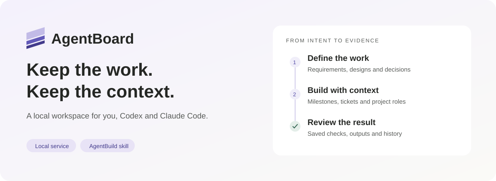
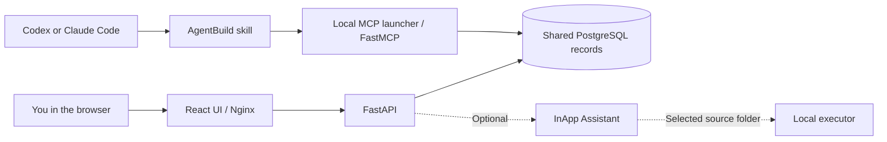

<p align="center">
  
</p>

<p align="center">
  <strong>Turn scattered agent sessions into project work you can follow.</strong>
</p>

<p align="center">
  <a href="LICENSE"></a>
  
  
</p>

<p align="center">
  <a href="#why-agentboard">Why AgentBoard</a> ·
  <a href="#install-the-service">Install service</a> ·
  <a href="#install-the-skill">Install skill</a> ·
  <a href="#first-project">First project</a> ·
  <a href="#software-bill-of-materials">Software BOM</a> ·
  <a href="#troubleshooting">Troubleshooting</a>
</p>

**AgentBoard** is a local project workspace for one person working with coding agents. **AgentBuild** is its reusable skill: four named workflows that connect Codex or Claude Code to the same project records through MCP.

The service works without a model API key. An optional InApp Assistant adds model-backed project conversations and reviewed editing tasks. A fresh installation starts empty; the author's projects, conversations and design snapshots are not bundled.

## Why AgentBoard

A useful chat can still leave you with a hard-to-follow project. Requirements live in one session, designs in another, and “done” arrives without a clear record of what was checked.

| Pain point | How AgentBoard helps |
| --- | --- |
| The next session loses the reasons behind a decision. | Keep requirements, designs and source-document relationships with the project. |
| Multiple agents work from different task descriptions. | Give them shared milestone tickets, context links, acceptance criteria and saved project roles. |
| A requested edit quietly changes the agreed scope. | Compare changes with saved requirements and record scope decisions in Runs & activity. |
| A completion message is hard to verify later. | Link output evidence, save reported run states and retain record history. |
| Planning tools and agent commands feel disconnected. | Read and update the same PostgreSQL records through the browser, API and MCP tools. |

AgentBoard records reported work. It does not supervise unrelated external agent processes, and a saved role is not proof that a specialist agent ran.

## What you can do

- **Plan:** manage projects, milestones, tickets, roles and documents.
- **Design:** prepare local Canvas drafts and publish approved versions with source revisions.
- **Deliver:** link Context and Output documents to tickets and follow dependencies.
- **Review:** inspect changes, reported runs, document impact and scope decisions.
- **Work visibly:** see saving/syncing states and open supplementary guidance through info controls.
- **Use the optional Assistant:** keep project chat and task history, with separately configured file execution and Git recovery.

## How the pieces fit



The skill supplies workflow instructions. The service stores records and enforces record validation and review gates. Installing one does not install the other.

## Install the service

### Requirements

| Requirement | Needed for |
| --- | --- |
| Git | Cloning the repository. |
| Docker with Compose v2 | Running the database, API and web service. Start Docker Desktop first if using it. |
| POSIX shell and OpenSSL | Running `scripts/setup.sh` and generating the local database password. |
| Internet access | Downloading dependencies and images during the first build. |
| Python 3.12+ on the host | Installing the skill or configuring optional file execution. The base service runs Python in Docker. |
| A local Codex or Claude Code host | Using AgentBuild through MCP. The browser app can be used independently. |

The shell commands below target macOS/Linux-style environments. Windows requires a compatible shell and Docker integration; native Windows installation has not been verified.

### Start

```sh
git clone https://github.com/CJsGit-tech/AgentBoard.git
cd AgentBoard
./scripts/setup.sh
```

Open **[AgentBoard at localhost:8080](http://127.0.0.1:8080)**.

Setup creates `.local/db_password` if missing, builds the images and starts the services. Keep this password with the database volume. Use the same setup command for later starts; it preserves configured execution settings and workspace data.

### Verify

```sh
docker compose ps
docker compose exec -T api python -c "import urllib.request; print(urllib.request.urlopen('http://127.0.0.1:8000/healthz').read().decode())"
```

Expected: `db`, `api` and `web` are running and healthy, and the API prints `{"status":"ok"}`. An empty Projects screen is expected on a new installation. The web proxy does not expose the API health endpoint at `localhost:8080/healthz`; use the container check above.

## Install the skill

Keep this checkout available: it contains both the canonical skill and the local MCP launcher.

### Codex

Run from the AgentBoard checkout:

```sh
python3 scripts/install-skill.py install --host codex --scope project
codex mcp add agentboard-mvp -- "$PWD/scripts/agentboard-mcp" Codex
```

The skill is installed at `.agents/skills/agentbuild/` in the selected project. Codex's explicit invocation policy is bundled in `agents/openai.yaml`.

### Claude Code

Run from the AgentBoard checkout:

```sh
python3 scripts/install-skill.py install --host claude --scope project
claude mcp add --scope local --transport stdio agentboard-mvp -- "$PWD/scripts/agentboard-mcp" Claude
```

The skill is installed at `.claude/skills/agentbuild/`. The installer adds Claude's explicit-only invocation setting. Its local MCP registration belongs to the directory where you run the registration command.

### Use another source repository

For either host, install into that repository using `--project /absolute/path/to/your/project`. Register MCP from that repository using the **absolute path** to AgentBoard's `scripts/agentboard-mcp`, keeping `Codex` or `Claude` as its argument. The launcher always connects to the AgentBoard checkout it belongs to.

For a personal skill installation across local projects, use `--scope personal`. Targets are `~/.agents/skills/agentbuild` for Codex and `~/.claude/skills/agentbuild` for Claude. Skill scope and MCP registration scope are separate choices. Legacy `~/.codex/skills` copies are not migrated automatically; preserve customizations and resolve duplicate copies deliberately.

Open a fresh host session if the skill or tools are not visible. Ask the host:

> Use the agentboard-mvp MCP server to list projects.

An empty list proves the connection works. The host must be able to run the local Docker CLI; this launcher is not a hosted/cloud connection.

## First project

In Codex:

```text
$agentbuild Setup My Project
```

In Claude Code:

```text
/agentbuild Setup My Project
```

Then use one of the four named workflows:

| Workflow | What you get | Example following the skill name |
| --- | --- | --- |
| **Setup** | Resolve/create a project, initialize missing default roles and check core documents. | `Setup My Project` |
| **Create Documents** | Prepare product, technical and design documents for review before saving. | `Create Documents for My Project. Draft the Product Brief.` |
| **Create Visuals** | Prepare a local interactive Canvas; publish the reviewed version when requested. | `Create Visuals for My Project. Show the onboarding flow.` |
| **Create Tickets** | Create Planned milestone tickets with context and acceptance criteria. | `Create Tickets for My Project, First Release. FE: build onboarding.` |

Ordinary conversation does not start a new workflow. Review document/design drafts before approving storage. A change to agreed scope requires your explicit decision. See the [complete command contracts](skills/agentbuild/references/commands.md) and [connection guide](skills/agentbuild/references/connection.md).

## Optional InApp Assistant

> [!WARNING]
> The InApp Assistant is experimental and has not been fully tested end to end. Use it with a disposable project or a backed-up source folder, and review file changes and saved results before relying on them.

The external Codex/Claude MCP connection does not require an OpenAI API key. The **InApp Assistant** is a separate, model-backed feature.

1. Open a project and select InApp Assistant.
2. Open Assistant settings, configure your key if needed, choose a model and test its connection. Provider usage may incur charges.
3. Page-entered keys are held in API process memory and must be entered again after restart. Alternatively, configure `OPENAI_API_KEY` in your private local `.env` before starting the service. The placeholder file is [.env.example](.env.example).
4. File access stays disabled until you explicitly select a host folder. A successful model connection does not grant file access.

To configure execution, preview the same folder selection before applying it:

```sh
python3 scripts/setup-execution.py --folder "/absolute/path/to/your/source-folder" --dry-run
python3 scripts/setup-execution.py --folder "/absolute/path/to/your/source-folder" --apply
```

Choose a dedicated source folder. Commands can access the entire selected folder; it is not a per-project operating-system sandbox. The executor has no network, provider key, database password or Docker socket. Dependencies needed by builds must already be available in its Linux environment. Editing also requires a reviewed ticket, Git and a Ready execution state. Inspect saved evidence before continuing or restoring an uncertain run.

## Updates, shutdown and data

| Task | Command or behavior |
| --- | --- |
| Rebuild/start the service | `./scripts/setup.sh` |
| Stop the base service | `docker compose stop` |
| Stop with file execution configured | `docker compose -f compose.yaml -f .local/execution.compose.yaml stop` |
| Update a managed skill | `python3 scripts/install-skill.py update --host codex --scope project` — substitute your host and reuse the original scope/project options. |
| Remove a managed skill | Use `uninstall` with the same options. This does not remove MCP registration or the service. |
| Recover an earlier skill copy | Updates save a backup outside skill discovery; use the path reported by the installer. Modified/unmanaged copies are refused rather than overwritten. |

Board records, chat and run history live in the `agentboard_mvp_workspace_v1` Docker volume. Record deletion and project removal have different protections: deleting a record normally moves it to Trash; permanently deleting a project uses a contents preview and exact-name confirmation.

**Do not run `docker compose down --volumes` on a working installation.** It removes stored workspace data. Preserve the database volume and its matching `.local/db_password` when moving or backing up the installation. There is no automated backup/restore procedure documented here; verify a restorable backup before attempting a move or upgrade of important data.

## Development and verification

Python 3.12+ and Node.js 22 are needed for these host-side checks:

```sh
python3 -m pip install -r scripts/requirements-checks.txt
python3 scripts/check-skills.py
python3 -m unittest discover -s scripts/tests -v
npm ci --prefix frontend
npm run build --prefix frontend
npm test --prefix frontend
```

With the local service running, backend integration checks can run inside the API container:

```sh
docker compose exec -T api python -m unittest discover -s tests -v
```

Backend integration tests create isolated temporary databases. Installer tests use temporary directories. Clean up task-owned fixtures, processes and browser sessions after verification, including failures. Prefer in-app or headless browsers and preserve existing user data and sessions. The workflow contract scenarios are static checks, not a live-model acceptance evaluation. Checks are run manually; GitHub automation is not included.

### Repository map

```text
AgentBoard/
|-- assets/                  Original README cover artwork
|-- backend/                 API, MCP, migrations, sample records and tests
|-- frontend/                React source, public assets, build config and tests
|-- skills/agentbuild/       Canonical skill, host metadata, references and helpers
|-- scripts/                Service setup, skill installer, checks and tests
|-- compose.yaml            Local service definitions
|-- .env.example            Optional Assistant configuration placeholder
|-- .dockerignore           Container build exclusions
|-- LICENSE                 MIT license for original work
`-- README.md               Introduction, installation and operation
```

Keep credentials, database dumps, dependencies, caches and generated host installations out of commits. The author's `.github/`, `docs/`, `demo/`, `walkthrough/`, `.gitignore`, design snapshots and V3-specific export/preview helpers are excluded from publication. A clone does not inherit the author's private ignore rules; review an explicit file list before committing. Design artifacts can be prepared locally through AgentBuild; a clone does not include the author's Canvas publications.

## Software bill of materials

This table covers direct application dependencies and the main toolchain at this checkout. It is **not an exhaustive transitive or container-image SBOM**. npm's exact resolved versions are in [package-lock.json](frontend/package-lock.json); Python direct pins are in [requirements.txt](backend/requirements.txt). Floating container tags can resolve to newer builds.

| Layer | Component | Version / declared image | Purpose | License |
| --- | --- | --- | --- | --- |
| UI | React / React DOM | 18.3.1 | Browser interface | MIT |
| UI | Mantine Core / Hooks | 7.17.8 | Components and interactions | MIT |
| UI | Interest invokers polyfill | 1.0.14 resolved | Hover/focus help compatibility | BSD-3-Clause |
| UI | Popover polyfill | 0.7.3 resolved | Popover compatibility | BSD-3-Clause |
| Build | Vite | 6.4.6 resolved | Frontend bundling | MIT |
| Build | TypeScript | 5.8.3 resolved | Type checking | Apache-2.0 |
| API | FastAPI | 0.165.0 | HTTP API | MIT |
| MCP | FastMCP | 4.2.2 | Agent tool interface | Apache-2.0 |
| API | Uvicorn | 0.54.0 | ASGI server | BSD-3-Clause |
| Database adapter | Psycopg | 3.2.6 | PostgreSQL access | LGPL-3.0 |
| Assistant | OpenAI Agents SDK | 0.25.0 | Optional model-backed agent runtime | MIT |
| Database | PostgreSQL | `postgres:17` | Persistent project records | PostgreSQL License |
| Runtime | Python | `python:3.12-slim` | API runtime | PSF; image includes separately licensed OS packages |
| Build / executor | Node.js | `node:22-alpine` / `node:22-bookworm` | Frontend build / optional execution tools | MIT; bundled components have additional terms |
| Web | Nginx | `nginx:stable-alpine` | Static UI and API proxy | BSD-2-Clause; image includes OS packages |
| Check tooling | PyYAML | 6.0.3 | Skill metadata checks | MIT |
| Assets | Inter / Phosphor icons | Bundled files | Typography and icons | SIL OFL-1.1 / MIT |

Original AgentBoard code and the AgentBuild skill use the [MIT license](LICENSE); the standalone skill includes its [own license copy](skills/agentbuild/LICENSE.txt). Preserve bundled [Inter](frontend/public/fonts/OFL-Inter.txt) and [Phosphor](frontend/public/LICENSE-phosphor) notices and dependency license terms.

## Troubleshooting

| Symptom | Check |
| --- | --- |
| Docker daemon unavailable | Start Docker Desktop/the Docker daemon, then rerun setup. |
| Port 8080 is already occupied | Stop the conflicting local process; do not terminate unrelated services automatically. |
| Browser loads but agents have no tools | Verify the chosen host's MCP registration and its access to Docker, then open a fresh host session. |
| Skill missing | Check the installation host/scope/project and duplicate legacy copies. The installer and MCP registration are separate. |
| Empty projects list | Expected for a fresh database; run Setup with your project name. |
| Assistant says Not configured | Configure its model connection or selected source folder as indicated; these are independent states. |
| Save outcome is uncertain | Read back saved state or use Retry sync before submitting the write again. |
| API health check fails | Inspect `docker compose ps` and `docker compose logs --tail=50 api db`; redact private values before sharing logs. |

## Support and contributions

For bugs or proposals, [open an issue](https://github.com/CJsGit-tech/AgentBoard/issues) with reproduction steps, expected behavior, environment and sanitized evidence. Before proposing code changes, run the relevant checks and explain the resulting behavior. Do not attach API keys, private conversations or database exports.

The supported deployment is a trusted local machine with loopback access. Public hosting, multi-user authentication and remote/cloud MCP transport are outside the supplied deployment. Local OS processes with Docker access are trusted.
