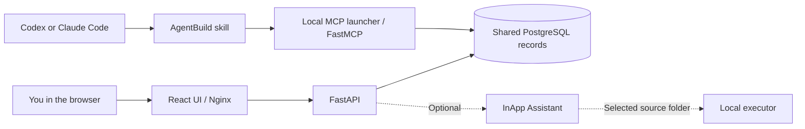

<p align="center">
  
</p>

<p align="center">
  <strong>One project. Shared context. Work you can verify.</strong>
</p>

<p align="center">
  <a href="LICENSE"></a>
  
  
</p>

<p align="center">
  <a href="#why-agentboard">🎯 Why</a> ·
  <a href="#install-the-service">🚀 Start service</a> ·
  <a href="#install-the-skill">🧩 Add skill</a> ·
  <a href="#first-project">🗂️ Workflows</a> ·
  <a href="#software-bill-of-materials">📦 Software BOM</a>
</p>

**AgentBoard** keeps your project’s requirements, designs, tickets and evidence together. **AgentBuild** connects that workspace to Codex or Claude Code.

> [!TIP]
> The board and external agent connection work **without a model API key**. A new installation starts with an empty workspace.

<a id="why-agentboard"></a>

## 🎯 Keep context between sessions

| When work gets scattered… | AgentBoard gives it a home |
| --- | --- |
| Decisions disappear in old chats. | **Shared requirements and designs**, linked to the work. |
| Agents follow different task descriptions. | **Milestones and tickets** with context, roles and acceptance criteria. |
| “Done” has no trail to inspect. | **Output evidence, scope decisions and history** you can revisit. |

**Plan** the work · **Design** the experience · **Build** with context · **Review** the result

<picture>
  <source media="(max-width: 600px)" srcset="assets/agentboard-system-mobile.svg">
  
</picture>

<details>
<summary><strong>How the service, skill and optional Assistant connect</strong></summary>



The skill supplies workflow instructions. The service stores records and enforces record validation and review gates. Installing one does not install the other.

AgentBoard records reported work. It does not supervise unrelated external agent processes; a saved role does not prove that a specialist agent ran.

</details>

<a id="install-the-service"></a>

## 🚀 Start the service

**Have ready:** Git, Docker with Compose v2, a POSIX shell and OpenSSL. Start Docker first; the first build needs internet access.

```sh
git clone https://github.com/CJsGit-tech/AgentBoard.git
cd AgentBoard
./scripts/setup.sh
```

**Open → [localhost:8080](http://127.0.0.1:8080)**

Setup builds the app, generates the local database password and preserves existing workspace data. Keep `.local/db_password` with the database volume.

<details>
<summary><strong>Full prerequisites and service health check</strong></summary>

### Requirements

| Requirement | Needed for |
| --- | --- |
| Git | Cloning the repository. |
| Docker with Compose v2 | Running the database, API and web service. Start Docker Desktop first if using it. |
| POSIX shell and OpenSSL | Running `scripts/setup.sh` and generating the local database password. |
| Internet access | Downloading dependencies and images during the first build. |
| Python 3.12+ on the host | Installing the skill or configuring optional file execution. The base service runs Python in Docker. |
| A local Codex or Claude Code host | Using AgentBuild through MCP. The browser app can be used independently. |

The shell commands below target macOS/Linux-style environments. Windows requires a compatible shell and Docker integration; native Windows installation has not been verified.

### Verify

```sh
docker compose ps
docker compose exec -T api python -c "import urllib.request; print(urllib.request.urlopen('http://127.0.0.1:8000/healthz').read().decode())"
```

Expected: `db`, `api` and `web` are running and healthy, and the API prints `{"status":"ok"}`. An empty Projects screen is expected on a new installation. The web proxy does not expose the API health endpoint at `localhost:8080/healthz`; use the container check above.

</details>

<a id="install-the-skill"></a>

## 🧩 Connect your coding agent

You need **Python 3.12+** and a local Codex or Claude Code installation. Run the commands for your host from the AgentBoard checkout.

### Codex

```sh
python3 scripts/install-skill.py install --host codex --scope project
codex mcp add agentboard-mvp -- "$PWD/scripts/agentboard-mcp" Codex
```

### Claude Code

```sh
python3 scripts/install-skill.py install --host claude --scope project
claude mcp add --scope local --transport stdio agentboard-mvp -- "$PWD/scripts/agentboard-mcp" Claude
```

**Check the connection:** open a fresh host session if needed, then ask it to **list projects using `agentboard-mvp`**. An empty list is a successful connection.

<details>
<summary><strong>Installation paths, another repository and personal scope</strong></summary>

Project skills go to `.agents/skills/agentbuild/` for Codex or `.claude/skills/agentbuild/` for Claude. The installer keeps explicit-only invocation settings for each host. The source bundle is [skills/agentbuild](skills/agentbuild/SKILL.md); installation does not start the service or register MCP.

For either host, install into that repository using `--project /absolute/path/to/your/project`. Register MCP from that repository using the **absolute path** to AgentBoard's `scripts/agentboard-mcp`, keeping `Codex` or `Claude` as its argument. The launcher always connects to the AgentBoard checkout it belongs to.

For a personal skill installation across local projects, use `--scope personal`. Targets are `~/.agents/skills/agentbuild` for Codex and `~/.claude/skills/agentbuild` for Claude. Skill scope and MCP registration scope are separate choices. Legacy `~/.codex/skills` copies are not migrated automatically; preserve customizations and resolve duplicate copies deliberately.

Open a fresh host session if the skill or tools are not visible. Ask the host:

> Use the agentboard-mvp MCP server to list projects.

An empty list proves the connection works. The host must be able to run the local Docker CLI; this launcher is not a hosted/cloud connection.

</details>

<a id="first-project"></a>

## 🗂️ Start with one named workflow

| Host | First message |
| --- | --- |
| Codex | `$agentbuild Setup My Project` |
| Claude Code | `/agentbuild Setup My Project` |

| Workflow | Outcome |
| --- | --- |
| **Setup** | Project, default roles and a core-document check. |
| **Create Documents** | Product, technical and design drafts for review. |
| **Create Visuals** | A local interactive Canvas; publish when requested. |
| **Create Tickets** | Planned milestone tickets with context and acceptance criteria. |

<details>
<summary><strong>Example prompts and review boundaries</strong></summary>

| Workflow | What you get | Example following the skill name |
| --- | --- | --- |
| **Setup** | Resolve/create a project, initialize missing default roles and check core documents. | `Setup My Project` |
| **Create Documents** | Prepare product, technical and design documents for review before saving. | `Create Documents for My Project. Draft the Product Brief.` |
| **Create Visuals** | Prepare a local interactive Canvas; publish the reviewed version when requested. | `Create Visuals for My Project. Show the onboarding flow.` |
| **Create Tickets** | Create Planned milestone tickets with context and acceptance criteria. | `Create Tickets for My Project, First Release. FE: build onboarding.` |

Ordinary conversation does not start a new workflow. Review document/design drafts before approving storage. A change to agreed scope requires your explicit decision. See the [complete command contracts](skills/agentbuild/references/commands.md) and [connection guide](skills/agentbuild/references/connection.md).

</details>

<a id="optional-inapp-assistant"></a>

## 🧪 Optional InApp Assistant

> [!WARNING]
> **Experimental — not fully tested end to end.** Use a disposable project or backed-up source folder. Review file changes and saved results before relying on them.

This is a separate, model-backed feature. **Provider usage may incur charges.** A model connection does not grant file access.

<details>
<summary><strong>Configure a model, key and selected source folder</strong></summary>

1. Open a project and select InApp Assistant.
2. Open Assistant settings, configure your key if needed, choose a model and test its connection. Provider usage may incur charges.
3. Page-entered keys are held in API process memory and must be entered again after restart. Alternatively, configure `OPENAI_API_KEY` in your private local `.env` before starting the service. The placeholder file is [.env.example](.env.example).
4. File access stays disabled until you explicitly select a host folder. A successful model connection does not grant file access.

To configure execution, preview the same folder selection before applying it:

```sh
python3 scripts/setup-execution.py --folder "/absolute/path/to/your/source-folder" --dry-run
python3 scripts/setup-execution.py --folder "/absolute/path/to/your/source-folder" --apply
```

Choose a dedicated source folder. Commands can access the entire selected folder; it is not a per-project operating-system sandbox. The executor has no network, provider key, database password or Docker socket. Dependencies needed by builds must already be available in its Linux environment. Editing also requires a reviewed ticket, Git and a Ready execution state. Inspect saved evidence before continuing or restoring an uncertain run.

</details>

<a id="updates-shutdown-and-data"></a>

## 🔄 Updates and your data

> [!IMPORTANT]
> Stop with `docker compose stop`. **Do not run `docker compose down --volumes` on a working installation** — it deletes stored workspace data.

<details>
<summary><strong>Service shutdown, skill updates and data storage</strong></summary>

| Task | Command or behavior |
| --- | --- |
| Rebuild/start the service | `./scripts/setup.sh` |
| Stop the base service | `docker compose stop` |
| Stop with file execution configured | `docker compose -f compose.yaml -f .local/execution.compose.yaml stop` |
| Update a managed skill | `python3 scripts/install-skill.py update --host codex --scope project` — substitute your host and reuse the original scope/project options. |
| Remove a managed skill | Use `uninstall` with the same options. This does not remove MCP registration or the service. |
| Recover an earlier skill copy | Updates save a backup outside skill discovery; use the path reported by the installer. Modified/unmanaged copies are refused rather than overwritten. |

Board records, chat and run history live in the `agentboard_mvp_workspace_v1` Docker volume. Record deletion and project removal have different protections: deleting a record normally moves it to Trash; permanently deleting a project uses a contents preview and exact-name confirmation.

**Do not run `docker compose down --volumes` on a working installation.** It removes stored workspace data. Preserve the database volume and its matching `.local/db_password` when moving or backing up the installation. There is no automated backup/restore procedure documented here; verify a restorable backup before attempting a move or upgrade of important data.

</details>

<a id="development-and-verification"></a>

## 🛠️ Development and verification

<details>
<summary><strong>Build, test and inspect the repository structure</strong></summary>

Python 3.12+ and Node.js 22 are needed for these host-side checks:

```sh
python3 -m pip install -r scripts/requirements-checks.txt
python3 scripts/check-skills.py
python3 -m unittest discover -s scripts/tests -v
npm ci --prefix frontend
npm run build --prefix frontend
npm test --prefix frontend
```

With the local service running, backend integration checks can run inside the API container:

```sh
docker compose exec -T api python -m unittest discover -s tests -v
```

Backend integration tests create isolated temporary databases. Installer tests use temporary directories. Clean up task-owned fixtures, processes and browser sessions after verification, including failures. Prefer in-app or headless browsers and preserve existing user data and sessions. The workflow contract scenarios are static checks, not a live-model acceptance evaluation. Checks are run manually; GitHub automation is not included.

### Repository map

```text
AgentBoard/
|-- assets/                  Original README cover artwork
|-- backend/                 API, MCP, migrations, sample records and tests
|-- frontend/                React source, public assets, build config and tests
|-- skills/agentbuild/       Canonical skill, host metadata, references and helpers
|-- scripts/                Service setup, skill installer, checks and tests
|-- compose.yaml            Local service definitions
|-- .env.example            Optional Assistant configuration placeholder
|-- .dockerignore           Container build exclusions
|-- LICENSE                 MIT license for original work
`-- README.md               Introduction, installation and operation
```

Keep credentials, database dumps, dependencies, caches and generated host installations out of commits. The author's `.github/`, `docs/`, `demo/`, `walkthrough/`, `.gitignore`, design snapshots and V3-specific export/preview helpers are excluded from publication. A clone does not inherit the author's private ignore rules; review an explicit file list before committing. Design artifacts can be prepared locally through AgentBuild; a clone does not include the author's Canvas publications.

</details>

<a id="software-bill-of-materials"></a>

## 📦 Software bill of materials

**MIT covers our original code.** Third-party libraries and assets retain their own licenses.

<details>
<summary><strong>View components, versions, purposes and licenses</strong></summary>

This table covers direct application dependencies and the main toolchain at this checkout. It is **not an exhaustive transitive or container-image SBOM**. npm's exact resolved versions are in [package-lock.json](frontend/package-lock.json); Python direct pins are in [requirements.txt](backend/requirements.txt). Floating container tags can resolve to newer builds.

| Layer | Component | Version / declared image | Purpose | License |
| --- | --- | --- | --- | --- |
| UI | React / React DOM | 18.3.1 | Browser interface | MIT |
| UI | Mantine Core / Hooks | 7.17.8 | Components and interactions | MIT |
| UI | Interest invokers polyfill | 1.0.14 resolved | Hover/focus help compatibility | BSD-3-Clause |
| UI | Popover polyfill | 0.7.3 resolved | Popover compatibility | BSD-3-Clause |
| Build | Vite | 6.4.6 resolved | Frontend bundling | MIT |
| Build | TypeScript | 5.8.3 resolved | Type checking | Apache-2.0 |
| API | FastAPI | 0.165.0 | HTTP API | MIT |
| MCP | FastMCP | 4.2.2 | Agent tool interface | Apache-2.0 |
| API | Uvicorn | 0.54.0 | ASGI server | BSD-3-Clause |
| Database adapter | Psycopg | 3.2.6 | PostgreSQL access | LGPL-3.0 |
| Assistant | OpenAI Agents SDK | 0.25.0 | Optional model-backed agent runtime | MIT |
| Database | PostgreSQL | `postgres:17` | Persistent project records | PostgreSQL License |
| Runtime | Python | `python:3.12-slim` | API runtime | PSF; image includes separately licensed OS packages |
| Build / executor | Node.js | `node:22-alpine` / `node:22-bookworm` | Frontend build / optional execution tools | MIT; bundled components have additional terms |
| Web | Nginx | `nginx:stable-alpine` | Static UI and API proxy | BSD-2-Clause; image includes OS packages |
| Check tooling | PyYAML | 6.0.3 | Skill metadata checks | MIT |
| Assets | Inter / Phosphor icons | Bundled files | Typography and icons | SIL OFL-1.1 / MIT |

Original AgentBoard code and the AgentBuild skill use the [MIT license](LICENSE); the standalone skill includes its [own license copy](skills/agentbuild/LICENSE.txt). Preserve bundled [Inter](frontend/public/fonts/OFL-Inter.txt) and [Phosphor](frontend/public/LICENSE-phosphor) notices and dependency license terms.

</details>

<a id="troubleshooting"></a>

## 🩺 Troubleshooting

<details>
<summary><strong>Find a symptom and its next check</strong></summary>

| Symptom | Check |
| --- | --- |
| Docker daemon unavailable | Start Docker Desktop/the Docker daemon, then rerun setup. |
| Port 8080 is already occupied | Stop the conflicting local process; do not terminate unrelated services automatically. |
| Browser loads but agents have no tools | Verify the chosen host's MCP registration and its access to Docker, then open a fresh host session. |
| Skill missing | Check the installation host/scope/project and duplicate legacy copies. The installer and MCP registration are separate. |
| Empty projects list | Expected for a fresh database; run Setup with your project name. |
| Assistant says Not configured | Configure its model connection or selected source folder as indicated; these are independent states. |
| Save outcome is uncertain | Read back saved state or use Retry sync before submitting the write again. |
| API health check fails | Inspect `docker compose ps` and `docker compose logs --tail=50 api db`; redact private values before sharing logs. |

</details>

## Questions or contributions?

[Open an issue](https://github.com/CJsGit-tech/AgentBoard/issues) with reproduction steps and sanitized evidence. Run the relevant checks before proposing changes.

**Local, single-machine deployment.** Public hosting, multi-user authentication and cloud MCP are outside the supplied setup. Local processes with Docker access are trusted. Keep keys, private conversations and database exports out of issues.
